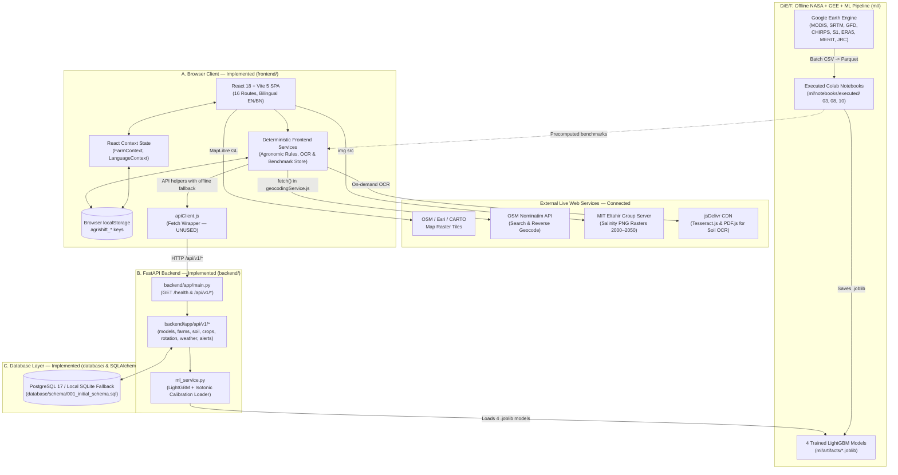

# AgriShift — System Architecture & Implementation Status

> **Audit Status:** Verified against the actual `AgriShift-Final-Repo` codebase and artifacts.  
> **Rule Applied:** Strictly distinguishes **Implemented**, **Partially implemented**, **Scaffolded**, **Planned**, and **Not yet verified**.

---

## 1. Implementation Status Summary

| Component | Status | Evidence in Repository |
| :--- | :--- | :--- |
| **React frontend (`frontend/`)** | **Implemented** | React 18 + Vite 5 SPA with 16 routes (15 feature routes + `/` home + `*` fallback) in [`frontend/src/App.jsx`](./frontend/src/App.jsx), verified by [`frontend/tests/verify-frontend.js`](./frontend/tests/verify-frontend.js) |
| **English / Bangla localization** | **Implemented** | Complete `423`-key translation dictionaries in [`frontend/src/locales/en.json`](./frontend/src/locales/en.json) and [`frontend/src/locales/bn.json`](./frontend/src/locales/bn.json) |
| **NASA / GEE processing scripts** | **Available** | 10-stage GEE export, dataset assembly, and training scripts in [`ml/data_pipeline/`](./ml/data_pipeline/) and [`ml/notebooks/pipeline/`](./ml/notebooks/pipeline/) |
| **Trained ML model artifacts** | **Available** | Four serialized LightGBM `.joblib` artifacts in [`ml/artifacts/`](./ml/artifacts/) (`drought_lgbm_reg_h1.joblib`, `flood_inundation_lgbm_h1.joblib`, `flood_waterlogging_lgbm_h1.joblib`, `surge_inundation_lgbm.joblib`) |
| **ML evaluation & notebooks** | **Partially verified** | Three executed Colab notebooks in [`ml/notebooks/executed/`](./ml/notebooks/executed/) (`03`, `08`, `10`) with held-out temporal & LOSO metrics; 5-fold spatial CV was skipped (`RUN_SPATIAL_CV = False`) and an earlier unarchived 48-feat drought variant (`0.6512`) is not reproducible from repo files |
| **Agronomic research database** | **Available** | Khulna crop database ([`agronomy/Crop Database/AgriShift_Khulna_Crop_Database.xlsx`](./agronomy/Crop%20Database/AgriShift_Khulna_Crop_Database.xlsx)) and validity analysis ([`agronomy/Crop Database/AgriShift_Agronomic_Validity_Analysis.docx`](./agronomy/Crop%20Database/AgriShift_Agronomic_Validity_Analysis.docx)); integrated into frontend evidence panel (`CropEvidencePanel.jsx`) |
| **FastAPI backend (`backend/`)** | **Implemented** | FastAPI service in [`backend/app/main.py`](./backend/app/main.py) exposing `GET /health` and `/api/v1/*` routes (`models`, `farms`, `regions`, `soil`, `crops`, `rotation`, `weather`, `alerts`), loading all 4 `.joblib` artifacts via [`backend/app/services/ml_service.py`](./backend/app/services/ml_service.py) and verified by [`backend/tests/test_api.py`](./backend/tests/test_api.py) (`12 passed`) |
| **Relational database (`database/`, `backend/app/models/`)** | **Implemented** | Canonical DDL in [`database/schema/001_initial_schema.sql`](./database/schema/001_initial_schema.sql), seed script in [`database/seeds/001_seed_khulna_agronomy.sql`](./database/seeds/001_seed_khulna_agronomy.sql), SQLAlchemy 2.0 ORM in [`backend/app/models/entities.py`](./backend/app/models/entities.py), `postgres:17-alpine` in [`docker-compose.yml`](./docker-compose.yml) with automatic SQLite fallback |
| **Frontend-to-Backend API wiring** | **Implemented (with Offline Fallback)** | [`frontend/src/services/apiClient.js`](./frontend/src/services/apiClient.js) is wired into `weatherService.js`, `farmService.js`, `cropService.js`, `rotationService.js`, `alertService.js`, and `modelService.js`, automatically falling back to local browser fixtures when offline |
| **IoT / ESP32 telemetry** | **Not yet implemented** | No firmware or sensor ingestion endpoints exist in this repository |
| **Production deployment** | **Unverified** | Requires live deployment verification of any hosted build and future backend/DB services |

---

## 2. High-Level System Architecture

---

## 3. Component-by-Component Breakdown

### A. Frontend (`frontend/`) — Implemented
- **Entry & Routing:** [`frontend/index.html`](./frontend/index.html) → [`frontend/src/main.jsx`](./frontend/src/main.jsx) → [`frontend/src/App.jsx`](./frontend/src/App.jsx), wrapped in [`Layout.jsx`](./frontend/src/components/layout/Layout.jsx) (`Navbar`, `Sidebar`, `Footer`).
- **Routes (16):** `/` ([`HomePage.jsx`](./frontend/src/pages/Home/HomePage.jsx)), `/farm-map`, `/dashboard`, `/weather-calendar`, `/soil-report`, `/crop-suitability`, `/rotation-planner`, `/what-if-simulator`, `/scenario-comparison`, `/alerts`, `/data-sources`, `/salinity-prediction`, `/ml-suitability`, `/intelligent-rotation`, `/model-evaluation`, `/soil-history`, plus `*` fallback (`NotFoundPage.jsx`).
- **State & Persistence:** [`LanguageContext.jsx`](./frontend/src/context/LanguageContext.jsx) (`423` EN/BN keys) and [`FarmContext.jsx`](./frontend/src/context/FarmContext.jsx) persist farm, soil, and language state in browser `localStorage`.
- **Services:** Deterministic agronomic calculators, client-side Tesseract/PDF soil-card OCR (`soilService.js`), and precomputed ML evaluation tables (`modelService.js`) work 100% offline and also expose async `/api/v1/*` helpers via [`apiClient.js`](./frontend/src/services/apiClient.js).

### B. Backend (`backend/`) — Implemented
- [`backend/app/main.py`](./backend/app/main.py) initializes the relational database (`init_and_seed_db()`) and loads all 4 LightGBM `.joblib` artifacts (`ml_registry.load_all()`) on startup.
- [`backend/app/api/router.py`](./backend/app/api/router.py) mounts `/api/v1/models`, `/api/v1/farms`, `/api/v1/regions`, `/api/v1/soil`, `/api/v1/crops`, `/api/v1/rotation`, `/api/v1/weather`, and `/api/v1/alerts`.
- [`backend/tests/test_api.py`](./backend/tests/test_api.py) verifies all 12 test cases covering ML hazard inference, honest `501 MODEL_NOT_YET_AVAILABLE` for satellite `ECe`, SRDI soil diagnostics (`ECe` vs `EC1:5` and `NULL` preservation), crop suitability, and rotation planning.

### C. Database (`database/`, `docker-compose.yml`) — Implemented
- [`database/schema/001_initial_schema.sql`](./database/schema/001_initial_schema.sql) defines the canonical tables (`sources`, `crops`, `crop_varieties`, `crop_stage_evidence`, `sites`, `plots`, `soil_samples`, `water_samples`, `rotation_treatments`, `rotation_treatment_steps`, `environmental_observations`) aligned with [`docs/RESEARCHER_CROP_ROTATION_DATA_GUIDE.md`](./docs/RESEARCHER_CROP_ROTATION_DATA_GUIDE.md).
- [`database/seeds/001_seed_khulna_agronomy.sql`](./database/seeds/001_seed_khulna_agronomy.sql) and [`backend/app/repositories/agronomy_repository.py`](./backend/app/repositories/agronomy_repository.py) seed SRDI/BRRI/BARI sources, the Dacope (Polder 31) demo farm, and 14 coastal crop varieties.
- [`backend/app/core/database.py`](./backend/app/core/database.py) connects to PostgreSQL (`docker-compose.yml`) when `DATABASE_URL` is configured and automatically falls back to local SQLite (`agrishift_local.db`) when Docker is not running.

### D. Machine Learning (`ml/`) — Available & Partially Verified
- **Artifacts ([`ml/artifacts/`](./ml/artifacts/)):**
  1. `drought_lgbm_reg_h1.joblib` (`1.50 MB`, `64` features, $\Delta\text{VCI}$ regressor)
  2. `flood_inundation_lgbm_h1.joblib` (`764 KB`, `105` features, calibrated classifier)
  3. `flood_waterlogging_lgbm_h1.joblib` (`1.75 MB`, `91` features, calibrated classifier)
  4. `surge_inundation_lgbm.joblib` (`352 KB`, `34` features, classifier)
- **Pipeline Code & Notebooks:** [`ml/data_pipeline/`](./ml/data_pipeline/) (`01`–`10` Python scripts), [`ml/notebooks/pipeline/`](./ml/notebooks/pipeline/) (`01`–`10` clean Colab notebooks), [`ml/notebooks/executed/`](./ml/notebooks/executed/) (`03`, `08`, `10` executed outputs), and [`ml/tests/`](./ml/tests/) (synthetic unit test suite).
- **Verification Gaps:** `drought_lgbm_cls_h1.joblib` is not in `ml/artifacts/`, 5-fold spatial CV was skipped (`RUN_SPATIAL_CV = False`) in the executed notebooks, and the frontend `ml/` artifacts are not yet served by a live backend inference endpoint.

### E. Google Earth Engine (`ml/data_pipeline/01, 04, 06`) — Available (Offline Batch)
- Scripts `01_export_gee.py`, `04_export_flood_gee.py`, and `06_export_surge_inundation_gee.py` export monthly and event-level CSVs over Khulna Division's `12,033` `1 km` cropland pixels (`MODIS/061/MCD12Q1` classes `12` & `14`) to Google Drive for offline dataset assembly.

### F. NASA & Partner Datasets — Verified in GEE Scripts
- **Executed in GEE:** `MODIS/061/MOD13A2` (`1 km`), `MODIS/061/MOD11A2` (`1 km`), `MODIS/061/MOD09A1` (`500 m`), `MODIS/061/MCD12Q1` (`500 m`), `USGS/SRTMGL1_003` (`30 m`), `GLOBAL_FLOOD_DB/MODIS_EVENTS/V1` (`250 m`), `UCSB-CHG/CHIRPS/DAILY` (`0.05°`), alongside ESA `COPERNICUS/S1_GRD`, ECMWF `ERA5_LAND`, `MERIT/Hydro/v1_0_1`, `JRC/GSW1_4`, and NOAA `IBTrACS v04r01`. Full provenance is in [`docs/nasa_data_sources.md`](./docs/nasa_data_sources.md).
- **UI-Referenced Only (Not Ingested in ML):** NASA SMAP, GPM IMERG, NASA POWER, MOD16A2, and Landsat 8/9 appear in `DataSourcesPage.jsx` (`isIngested: false`) and `nasaTelemetryService.js` as reference metadata, not ML training inputs.

### G. Agronomic Research (`agronomy/`) — Available
- [`agronomy/Crop Database/AgriShift_Khulna_Crop_Database.xlsx`](./agronomy/Crop%20Database/AgriShift_Khulna_Crop_Database.xlsx) and [`agronomy/Crop Database/AgriShift_Agronomic_Validity_Analysis.docx`](./agronomy/Crop%20Database/AgriShift_Agronomic_Validity_Analysis.docx) document local crop varieties, salinity tolerances, and research caveats, surfaced in [`CropEvidencePanel.jsx`](./frontend/src/components/crops/CropEvidencePanel.jsx).

### H. Data Flow Between Components
1. **Offline EO → ML Flow (Executed):** GEE (`01`, `04`, `06`) → Parquet Builders (`02`, `05`, `07`, `09`) → LightGBM Training (`03`, `08`, `10`) → `.joblib` artifacts in `ml/artifacts/` & evaluation metrics in `ml/notebooks/executed/`.
2. **Browser Runtime Flow (Implemented):** User interaction → React Context + `localStorage` → Deterministic JS rule engines & precomputed benchmarks (`modelService.js`) + live OSM Nominatim / tile servers / MIT PNG rasters / jsDelivr OCR.
3. **Frontend → Backend → DB / ML Flow (Planned, Not Connected):** `apiClient.js` → FastAPI `/api/v1/*` → PostgreSQL + `ml/artifacts/*.joblib` inference.
